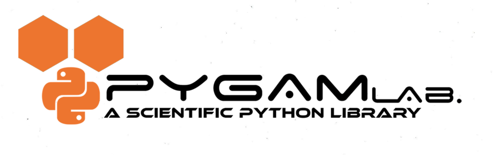

<h1 align="center">PyGamLab</h1>

<p align="center">
  
</p>

<p align="center"><i>PyGamLab is a scientific Python library for researchers, engineers, and students who need powerful tools for nanostructure generation, alloy design, material data exploration, and AI-driven analysis. Designed for simplicity, clarity, and usability.</i></p>


<p align="center">
  <!-- PyPI Version -->
  <a href="https://pypi.org/project/PyGamLab/">
    
  </a>

  <!-- GitHub Stars 
  <a href="https://github.com/APMaii/pygamlab">
    
  </a>-->

  <!-- GitHub Actions Build 
  <a href="https://github.com/APMaii/pygamlab/actions">
    
  </a>-->

  <!-- PyPI Downloads (pepy.tech total) -->
  <a href="https://pepy.tech/projects/pygamlab">
    
  </a>
  <!-- Documentation -->
  <a href="https://apmaii.github.io/pygamlab/documentation.html">
    
  </a>

  <!-- PyPI Downloads (Shields.io) -->
  <a href="https://pypi.org/project/PyGamLab/">
    
  </a>

  <!-- License -->
  <a href="https://github.com/APMaii/pygamlab/blob/main/LICENSE">
    
  </a>
</p>


## 📌 Overview

**PyGamLab** stands for *Python GAMLAb tools*, a collection of scientific tools and functions developed at the **GAMLab (Graphene and Advanced Material Laboratory)** by **Ali Pilehvar Meibody** under the supervision of **Prof. Malek Naderi** at **Amirkabir University of Technology (AUT)**.

- **Main Author:** Ali Pilehvar Meibody  
- **Supervisor:** Prof. Malek Naderi  
- **Co-Author:** Danial Nekoonam  
- **Contributor:** Shokoofeh Karimi  
- **Affiliation:** GAMLab, Amirkabir University of Technology (AUT)  

---

## 📦 Modules  

**PyGamLab** consists of several core modules, each focused on materials modeling, nanoscience, and data-driven discovery.

---

### 🧱 `Structure`  

Provides tools to **generate, manipulate, and analyze nanoscale and bulk materials**.  

**Key Features:**  
- Generate **0D (clusters, nanoparticles)**, **1D (nanowires, nanotubes)**, **2D (nanosheets, thin films)**, and **bulk crystals**.  
- Automated builders for **nanoclusters, nanotubes, and supercells**.  
- Geometric operations: **rotation, translation, scaling, merging, slicing**, and **symmetry analysis**.  
- Supports formats: `.cif`, `.xyz`, `.pdb`, `.vasp`, `.json`, etc.  
- Integration with **ASE** and **Pymatgen** via built-in converters.  

---

### 🎨 `GAMVis`  

**Internal visualization engine** for interactive 2D and 3D visualization of molecules, nanostructures, and crystals.  

**Capabilities:**  
- Real-time 2D/3D visualization  
- Graphical representation of bonds, surfaces, and charge distributions  
- Export publication-quality figures and animations  

---

### 🤖 `Ai_core`  

Integrates **machine learning workflows** into materials research.  

**Highlights:**  
- Automated regression, classification, and clustering workflows  
- Access to 140+ pre-trained models  
- Fine-tuning and inference on user data  
- Predict material properties: band gap, formation energy, hardness  
- Built-in tools for data splitting, validation, and evaluation  

---

### 🧬 `databases`  

Provides seamless access to multiple **materials databases**.  

**Supported Databases:**  
- Materials Project (MP)  
- AFLOW  
- JARVIS  
- Crystallography Open Database (COD)  

**Available Data:**  
- Mechanical, electronic, thermodynamic properties  
- Structural and crystallographic information  
- Chemical composition and symmetry  

A universal class **`GAM_Explorer`** unifies data retrieval across databases.  

---

### 📊 `Data_Analysis`  

Tools for **data preprocessing, analysis, and visualization**.  

**Main Features:**  
- Read and preprocess data from files or DataFrames  
- Filtering, normalization, and feature extraction  
- Publication-ready plots: line, scatter, histogram, heatmap  
- 68+ experimental analysis tools (NMR, XPS, XRD, UV-Vis, Raman)  
- Scientific constants, unit converters, and utilities  

---

### 🔹 `Constants.py`
Includes comprehensive scientific constants in physics, chemistry, and engineering.

Examples: Planck's constant, Boltzmann constant, speed of light, universal gas constant, density and melting points of metals.

---

### 🔹 `Convertors.py`
Contains unit conversion functions that follow the format:  
`FirstUnit_To_SecondUnit()`

Examples:
- `Kelvin_To_Celsius(k)`
- `Celsius_To_Kelvin(c)`
- `Meter_To_Foot(m)`
- ...and many more standard conversions used in science and engineering.

---

### 🔹 `Functions.py`
This module provides a wide collection of **scientific formulas and functional tools** commonly used in engineering applications.

Examples:
- Thermodynamics equations
- Mechanical stress and strain calculations
- Fluid dynamics formulas
- General utility functions


---

## 📦 Requirements

To use **PyGamLab**, make sure you have the following Python packages installed:

- `numpy`
- `pandas`
- `scipy`
- `matplotlib`
- `seaborn`
- `scikit-learn`
- `ase`
- `plotly`
- `PyQt5`
- `jarvis`
- `mp_api`
- `aflow`

You can install all dependencies using:

```bash
pip install numpy pandas scipy matplotlib seaborn scikit-learn json scipy ase plotly PyQt5
```


---

## 🚀 Installation

To install PyGAMLab via pip:

```bash
pip install pygamlab
```

or

```bash
git clone https://github.com/APMaii/pygamlab.git
```

---

## 📖 Usage Example

```python
import pygamlab


#--------------Constants-----------------------
import pygamlab.Constants as gamcn

print(gamcn.melting_point_of_Cu)
print(gamcn.melting_point_of_Al)
print(gamcn.Fe_Tm_Alpha)
print(gamcn.Fe_Tm_Gama)

print(gamcn.Boltzmann_Constant)
print(gamcn.Faraday_Constant)


#----------Converters------------------------
import pygamlab.Converters as gamcv

print(gamcv.Kelvin_to_Celcius(300))           # Convert 300 K to °C
print(gamcv.Coulomb_To_Electron_volt(1))      # Convert 1 Coulomb to eV
print(gamcv.Angstrom_To_Milimeter(1))         # Convert 1 Å to mm
print(gamcv.Bar_To_Pascal(1))                 # Convert 1 bar to Pascal

#-----------Functions------------------------
import pygamlab.Functions as gamfunc

# Gibb's Free Energy: G = H0 - T*S0
H0 = 100  # Enthalpy in kJ/mol
T = 298   # Temperature in Kelvin
S0 = 0.2  # Entropy in kJ/mol·K
print(gamfunc.Gibs_free_energy(H0, T, S0))


# Electrical Resistance: R = V / I
voltage = 10         # in Volts
current = 2          # in Amperes
print(gamfunc.Electrical_Resistance(voltage, current))

# Hall-Petch Relationship: σ = σ0 + k / √d
d_grain = 0.01       # Grain diameter in mm
sigma0 = 150         # Friction stress in MPa
k = 0.5              # Strengthening coefficient in MPa·mm^0.5
print(gamfunc.Hall_Petch(d_grain, sigma0, k))


#-----------Data_Analysis--------------------
import pygamlab.Data_Analysis as gamdat
import pandas as pd

df= pd.read_csv('/users/apm/....../data.csv')
gamdat.Stress_Strain1(df, 'PLOT')
my_uts=gamdat.Stress_Strain1(df, 'UTS')


data=pd.read_csv('/users/apm/....../data.csv')
my_max=gamdat.Xrd_Analysis(data,'max intensity')
gamdat.Xrd_Analysis(data,'scatter plot')
gamdat.Xrd_Analysis(data,'line graph')


#-----------Structures--------------------

from pygamlab.structures.Generators import Nano_ZeroD_Builder

builder=Nano_ZeroD_Builder(material='Au', crystal_structure='fcc', lattice_constant=2.14)

Au_atoms=builder.get_atoms()

from pygamlab.structures.gamvis import Molecular_Visualizer

Molecular_Visualizer(Au_atoms,format='gamvis')

Molecular_Visualizer(Au_atoms,format='ase')

Molecular_Visualizer(Au_atoms,format='matplotlib')


from pygamlab.structures.GAM_architectures import Nano_ZeroD_Builder

builder=Graphene(lattice_constant=2.46, width=10, length=82, edge_type='zigzag' )

graphene_atoms=builder.get_atoms()

from pygamlab.structures.gamvis import Molecular_Visualizer

Molecular_Visualizer(graphene_atoms,format='gamvis')

Molecular_Visualizer(graphene_atoms,format='ase')

Molecular_Visualizer(graphene_atoms,format='matplotlib')


#-----------databases--------------------

from pygamlab.databases.Main_DB import GAM_Explorer


explorer=GAM_Explorer(backend='aflow',timeout=60,max_results=5,batch_size=10)


explorer.search_materials(formula='SiO2')


mechanical_properties=explorer.fetch_mechanical_properties()


electronic_properties=explorer.fetch_electronic_properties()


#--------------Ai Core--------------------
from pygamlab.ai_core import Gam_Ai_Workflow


workflow=Gam_Ai_Workflow('Graphene-armchair-rf')

workflow.summary()

workflow.predict(range(0,100))


workflow.evaluate_regressor()


```

---
## 📚 Documentation

For detailed documentation, please visit the official [PyGamLab Documentation](https://apmaii.github.io/pygamlab/index.html).


---

## 📁 Project Structure

### 🔹 High-Level Overview

```
pygamlab/
├── Constants.py
├── Convertors.py
├── Functions.py
├── Data_Analysis.py
├── contributors.md
├── structures/
├── io/
├── databases/
└── ai_core/
```
---

### 🔍 Detailed Structure
```

pygamlab/
├── init.py
├── Constants.py
├── Convertors.py
├── Functions.py
├── Data_Analysis.py
└── contributors.md
├── structures/
│ ├── Primatom/
│ │ ├── init.py
│ │ ├── gam_universe.py
│ │ └── gam_molecule.py
│ ├── Generators/
│ │ ├── init.py
│ │ ├── zero_d.py
│ │ ├── one_d.py
│ │ ├── two_d.py
│ │ └── auto_bulk.py
│ ├── GAM_architectures/
│ │ ├── init.py
│ │ ├── GAM_Graphene.py
│ │ ├── GAM_phosphorene.py
│ │ ├── GAM_sillicene.py
│ │ ├── GAM_nano_particles.py
│ │ └── GAM_nanotubes.py
│ └── gamvis/
│   ├── init.py
│   ├── gamvis.py
│   └── gamvis_engine.py
├── io/
│ ├── init.py
│ ├── read.py
│ ├── export.py
│ ├── checker.py
│ └── conversions.py
├── databases/
│ ├── init.py
│ ├── Main_DB.py
│ ├── COD.py
│ ├── Material_projects.py
│ ├── Jarvis.py
│ └── Aflow.py
└── ai_core/
│ ├── init.py
│ ├── gam_ai.py
│ └── gam_models/
│   ├── init.py
│   ├── files.gam_ai
│   └── ...
```


---
## 🤝 Contributing

**Contributions** are welcome! Here's how to get started:

Fork the repository.
Create your feature branch 

```bash
git checkout -b feature/my-feature
```
Commit your changes 
```bash
git commit -am 'Add some feature'
```
Push to the branch 
```bash
git push origin feature/my-feature
```
Create a new Pull Request.
Please make sure to update tests as appropriate and follow PEP8 guidelines.


---
## 📄 License

This project is licensed under the MIT License — see the LICENSE.txt file for details


---

## 🙏 Acknowledgements

This project is part of the scientific research activities at **GAMLab (Generalized Applied Mechanics Laboratory)**  at **Amirkabir University of Technology (AUT)**.

Special thanks to:

- **Prof. Malek Naderi** – For his guidance, mentorship, and continuous support.
- **Ali Pilehvar Meibody** – Main developer and author of PyGamLab.
- **Danial Nekoonam** –  Co-Author of PyGamLab.
- **Shokoofeh Karimi** - For her Contribution of verify and testing most functions 
- **GAMLab Research Group** – For providing a collaborative and innovative environment.
- **Hossein Behjoo** – For his guidance in taking the AI courses and his creative work in the development of the logo.

We would also like to thank **all the students who participated in the GAMLab AI course** and contributed to the growth and feedback of this project. Their names are proudly listed in the [contributors.md](contributors.md) file.

This project was made possible thanks to the powerful Python open-source ecosystem:  
`NumPy`, `SciPy`, `Pandas`, `Matplotlib`, `Seaborn`, `Scikit-learn`, and many more.

---


