⚙️ **2. Generators**
~~~~~~~~~~~~~~~~~~~~

The Generators subpackage provides a dimensionality-based material
generation system. Unlike GAM_architectures, which focuses on specific
lattice-defined materials, Generators enables the creation of
general-purpose nanostructures and bulk materials with customizable
composition, defects, and topology.

This approach allows users to systematically explore materials across
different dimensions — from discrete nanoclusters to extended 3D solids
— while maintaining full control over atomic arrangements and boundary
conditions.

🎯 Purpose:

To build, modify, and analyze nanomaterials across 0D, 1D, 2D, and 3D
domains using flexible, parameter-driven builders.

🔹 Submodules under Generators:

Submodule Dimensionality Description

**zero_d 0D (Zero-Dimensional)**

Generates nanoclusters, nanoparticles, or core-shell systems, including
alloys and defected structures.

**one_d 1D (One-Dimensional)**

Builds nanowires, nanotubes, or nanorods with optional defects, dopants,
or lattice relaxation.

**two_d 2D (Two-Dimensional)**

Creates nanosheets and monolayers such as graphene, silicene, TMDs, and
phosphorene, supporting both periodic and finite configurations.

**auto_bulk 3D (Bulk)**

Constructs bulk crystalline materials and multi-component alloys with
customizable lattice parameters and supercell sizes.

Each generator integrates seamlessly with the Molecular_Visualizer
utility, supporting multiple visualization modes (plotly, matplotlib,
and pyvista) for interactive analysis of atomic structures.

⚪ **Category 1 – Zero-Dimensional (0D) Nanostructures**
~~~~~~~~~~~~~~~~~~~~~~~~~~~~~~~~~~~~~~~~~~~~~~~~~~~~~~~~

Zero-dimensional (0D) nanostructures are nanoscale materials that are
confined in all three spatial dimensions (x, y, and z). This means
electrons, phonons, and other excitations are quantized in every
direction, giving rise to unique quantum confinement effects.

Common examples include:

Nanoclusters – small aggregates of atoms with discrete electronic
states.

Nanoparticles – larger, often crystalline, particles with tunable size
and surface morphology.

Quantum dots – semiconductor 0D structures exhibiting size-dependent
optical properties.

These materials often show size-dependent color, reactivity, and
electronic behavior, making them essential in:

Catalysis (due to high surface-to-volume ratio)

Optoelectronics and quantum devices (e.g., LEDs, quantum dots)

Biomedical imaging and drug delivery

The Nano_ZeroD_Builder class in PyGamLab allows the creation of such 0D
nanostructures by defining their composition, size, crystal structure,
and even defects or alloy configurations.

Below are five examples demonstrating different types of 0D
nanostructures — from simple nanoclusters to multi-element alloys.

🔹 Example 1 – Gold Nanocluster (material=“Au”, size=4, noshells=4, fcc lattice=4.08 Å)
~~~~~~~~~~~~~~~~~~~~~~~~~~~~~~~~~~~~~~~~~~~~~~~~~~~~~~~~~~~~~~~~~~~~~~~~~~~~~~~~~~~~~~~

In this example, a gold (Au) nanocluster is created with 4 atomic shells
using an FCC (face-centered cubic) crystal structure. The lattice
constant of gold is set to 4.08 Å, and the cluster size is limited to a
few nanometers, corresponding to a few dozen atoms.

Nanoclusters like this are highly relevant for catalysis and plasmonic
studies, where small changes in size can drastically affect optical
absorption and surface energy.

.. code:: ipython3

    from pygamlab.structures.Generators.zero_d import Nano_ZeroD_Builder 
    
    from pygamlab.structures.gamvis import Molecular_Visualizer 
    
    builder = Nano_ZeroD_Builder(material="Au", structure_type="nanocluster", size=4, noshells=4, crystal_structure="fcc", lattice_constant=4.08)
    zerod1=builder.atoms 
     
    Molecular_Visualizer(zerod1,format='efficient_plotly') 
    Molecular_Visualizer(zerod1,format='matplotlib') 
    Molecular_Visualizer(zerod1,format='pyvista') 

.. parsed-literal::

    Visualizing 147 atoms using efficient_plotly format...

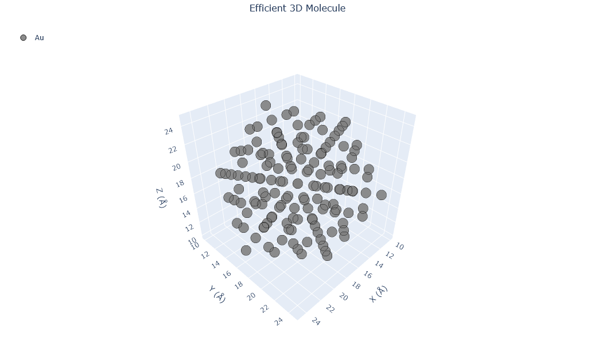

.. parsed-literal::

    Visualizing 147 atoms using matplotlib format...

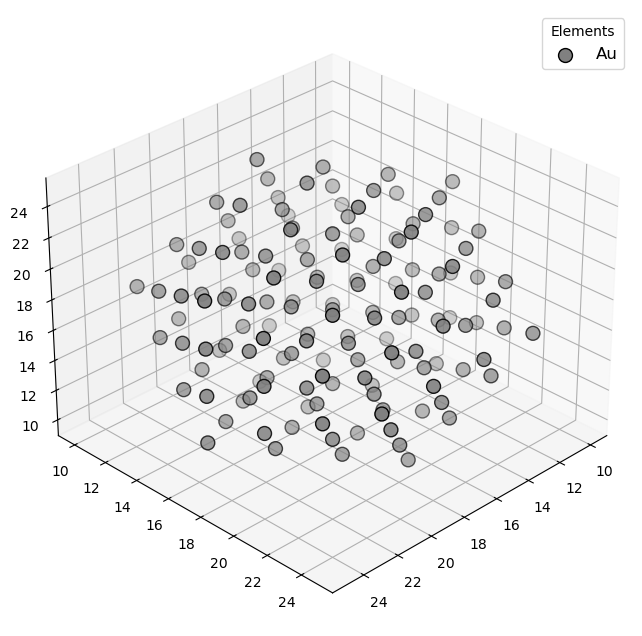

🔹 Example 2 – Copper Nanocluster (material=“Cu”, size=5, noshells=5, fcc lattice=3.61 Å)
~~~~~~~~~~~~~~~~~~~~~~~~~~~~~~~~~~~~~~~~~~~~~~~~~~~~~~~~~~~~~~~~~~~~~~~~~~~~~~~~~~~~~~~~~

This case generates a copper (Cu) nanocluster composed of five atomic
shells, with an FCC structure and a lattice constant of 3.61 Å. Compared
to gold, copper clusters often exhibit stronger metallic bonding and
different surface reconstruction behavior.

Such small Cu nanoclusters are useful in catalytic CO₂ reduction and
hydrogen evolution applications due to their tunable active surface
sites.

.. code:: ipython3

    from pygamlab.structures.Generators.zero_d import Nano_ZeroD_Builder 
    
    from pygamlab.structures.gamvis import Molecular_Visualizer 
    
    builder = Nano_ZeroD_Builder(material="Cu", structure_type="nanocluster", size=5, noshells=5, crystal_structure="fcc", lattice_constant=3.61)
    zerod2=builder.atoms 
    
    Molecular_Visualizer(zerod2,format='efficient_plotly') 
    Molecular_Visualizer(zerod2,format='matplotlib') 
    #Molecular_Visualizer(zerod2,format='pyvista') 

.. parsed-literal::

    Visualizing 309 atoms using efficient_plotly format...

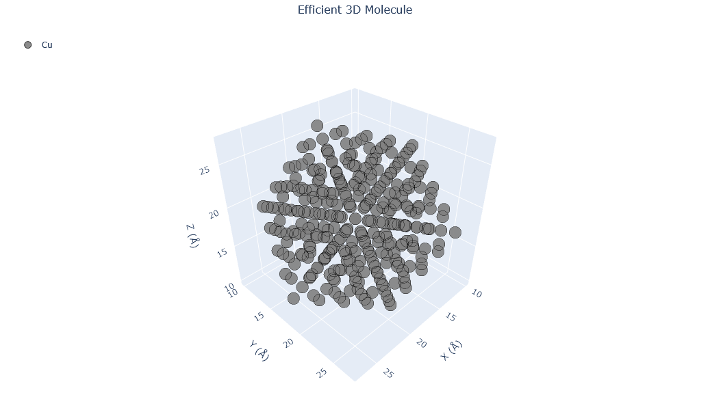

.. parsed-literal::

    Visualizing 309 atoms using matplotlib format...

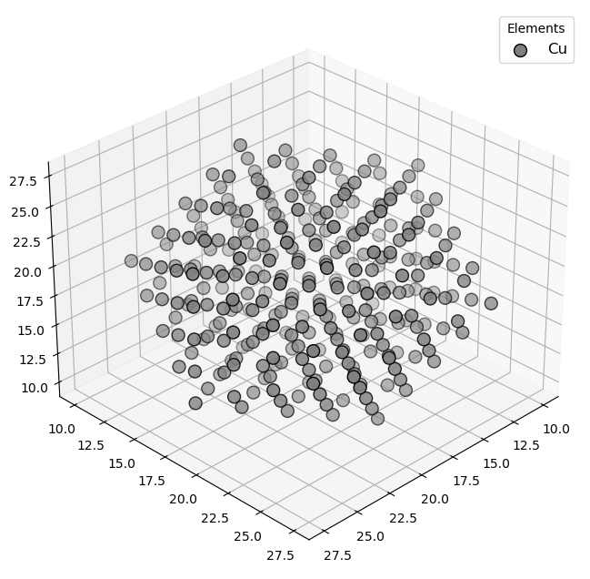

🔹 Example 3 – Gold Nanoparticle with Defects (material=“Au”, size=80, surfaces=[(111),(100)], defects=interstitials 5% H/C)
~~~~~~~~~~~~~~~~~~~~~~~~~~~~~~~~~~~~~~~~~~~~~~~~~~~~~~~~~~~~~~~~~~~~~~~~~~~~~~~~~~~~~~~~~~~~~~~~~~~~~~~~~~~~~~~~~~~~~~~~~~~~

Here, a larger gold nanoparticle (≈80 Å) is generated, exposing both the
(111) and (100) crystal facets with respective surface energies of 0.5
and 0.7 J/m². Defects are introduced using add_defects() — in this case,
interstitial atoms (H and C) at 5% concentration.

This mimics real experimental nanoparticles where surface defects and
impurities can alter catalytic activity, adsorption behavior, and
electronic density at the surface.

.. code:: ipython3

    from pygamlab.structures.Generators.zero_d import Nano_ZeroD_Builder 
    
    from pygamlab.structures.gamvis import Molecular_Visualizer 
    
    builder = Nano_ZeroD_Builder(material="Au", structure_type="nanoparticle", size=80, lattice_constant=4.08,surfaces=[(1,1,1),(1,0,0)],surface_energies=[0.5,0.7])
    builder.add_defects(defect_type="interstitial", concentration=0.05, elements=["H", "C"])
    zerod3=builder.atoms 
    
    
    Molecular_Visualizer(zerod3,format='efficient_plotly') 
    Molecular_Visualizer(zerod3,format='matplotlib') 
    Molecular_Visualizer(zerod3,format='pyvista') 

.. parsed-literal::

    Visualizing 89 atoms using efficient_plotly format...

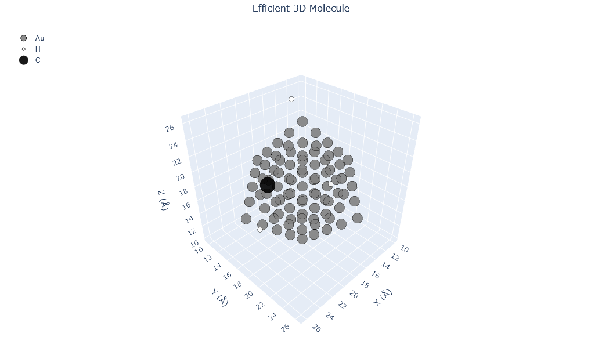

.. parsed-literal::

    Visualizing 89 atoms using matplotlib format...

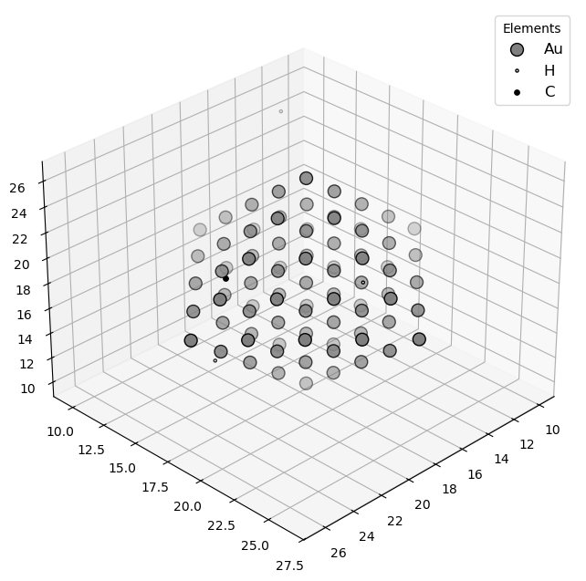

🔹 Example 4 – Au–Si Alloy Nanoparticle (elements=[“Au”, “Si”], compositions=[0.5, 0.5])
~~~~~~~~~~~~~~~~~~~~~~~~~~~~~~~~~~~~~~~~~~~~~~~~~~~~~~~~~~~~~~~~~~~~~~~~~~~~~~~~~~~~~~~~

In this example, the builder creates a binary alloy nanoparticle
containing 50% gold and 50% silicon atoms. Such Au–Si alloys are
well-known for their role in nanowire growth (VLS mechanism) and
heterogeneous catalysis.

Alloying alters the bonding environment and lattice strain, leading to
modified optical, mechanical, and chemical properties compared to pure
gold nanoparticles.

.. code:: ipython3

    from pygamlab.structures.Generators.zero_d import Nano_ZeroD_Builder 
    
    from pygamlab.structures.gamvis import Molecular_Visualizer 
    
    builder = Nano_ZeroD_Builder(material="Au", structure_type="nanoparticle", size=80, lattice_constant=4.08,surfaces=[(1,1,1),(1,0,0)],surface_energies=[0.5,0.7])
    builder.create_alloy(elements=["Au", "Si"], compositions=[0.5, 0.5])
    zerod4=builder.atoms 
    
    Molecular_Visualizer(zerod4,format='efficient_plotly') 
    Molecular_Visualizer(zerod4,format='matplotlib') 
    #Molecular_Visualizer(zerod4,format='pyvista') 

.. parsed-literal::

    Visualizing 85 atoms using efficient_plotly format...

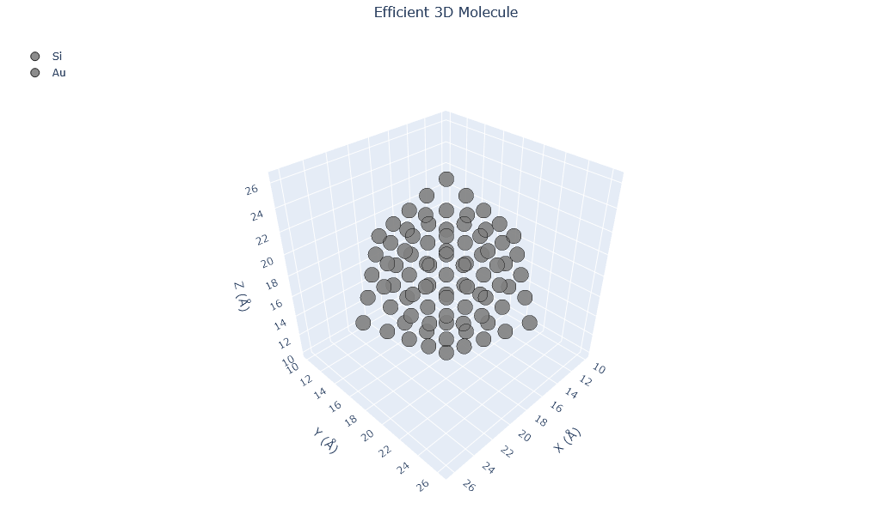

.. parsed-literal::

    Visualizing 85 atoms using matplotlib format...

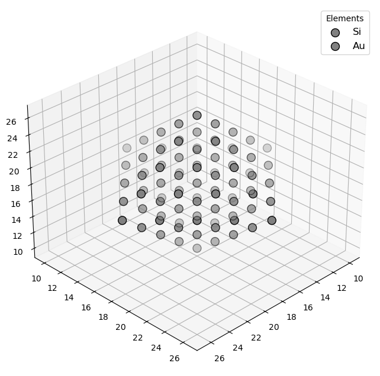

🔹 Example 5 – Cu–Ni–Co Multi-Component Alloy Nanoparticle (elements=[“Cu”,“Ni”,“Co”], compositions=[0.3,0.4,0.3])
~~~~~~~~~~~~~~~~~~~~~~~~~~~~~~~~~~~~~~~~~~~~~~~~~~~~~~~~~~~~~~~~~~~~~~~~~~~~~~~~~~~~~~~~~~~~~~~~~~~~~~~~~~~~~~~~~~

This final example demonstrates a ternary alloy nanoparticle composed of
Cu, Ni, and Co in proportions of 30%, 40%, and 30%, respectively. Such
high-entropy alloy (HEA) nanoparticles are a cutting-edge class of
materials known for their exceptional structural stability, catalytic
efficiency, and resistance to oxidation.

The random mixing of different metallic atoms leads to unique surface
geometries and heterogeneous electronic distributions, which can
significantly enhance catalytic and magnetic performance.

.. code:: ipython3

    from pygamlab.structures.Generators.zero_d import Nano_ZeroD_Builder 
    
    from pygamlab.structures.gamvis import Molecular_Visualizer 
    
    builder.create_alloy(elements=["Cu", "Ni", "Co"], compositions=[0.3, 0.4, 0.3])
    zerod5=builder.atoms 
    
    Molecular_Visualizer(zerod5,format='efficient_plotly') 
    Molecular_Visualizer(zerod5,format='matplotlib') 
    #Molecular_Visualizer(zerod5,format='pyvista') 

.. parsed-literal::

    Visualizing 85 atoms using efficient_plotly format...

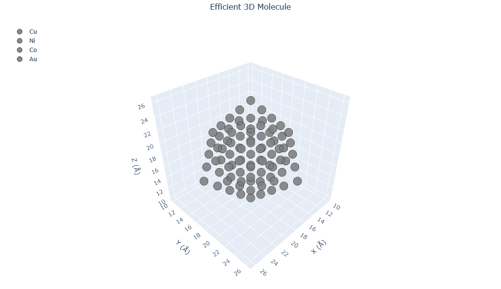

.. parsed-literal::

    Visualizing 85 atoms using matplotlib format...

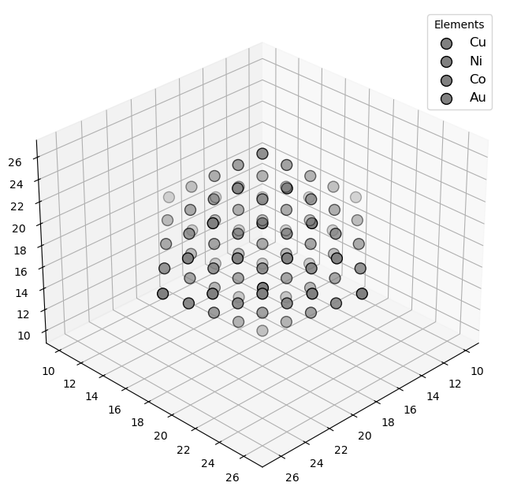

🧵 **Category 2 – One-Dimensional (1D) Nanostructures**
~~~~~~~~~~~~~~~~~~~~~~~~~~~~~~~~~~~~~~~~~~~~~~~~~~~~~~~

One-dimensional (1D) nanostructures are materials that are confined in
two spatial dimensions (x and y), but extended in one dimension (z).
This means electrons and phonons can move freely only along the length
of the structure, while motion in the other two directions is quantized.

Common 1D nanostructures include:

Nanowires

Nanorods

Nanotubes

Because of their high aspect ratio (length≫diameter), they show
anisotropic mechanical, electrical, and optical properties. They are key
components in:

Nanoelectronics (as conductive or semiconductive channels)

Photonic and plasmonic devices

Sensors and catalysis platforms

In PyGamLab, the Nano_OneD_Builder class enables precise generation of
1D nanostructures by specifying parameters such as:

Material type (C, Au, Si, etc.)

Crystal structure and lattice constant

Length and radius

Vacuum spacing (for periodic simulations)

Defect engineering (vacancies, interstitials, dopants)

Below are five examples demonstrating how different 1D nanostructures
can be generated, visualized, and customized.

🔹 Example 1 – Carbon Nanotube (material=“C”, structure_type=“nanotube”, length=5.0, vacuum=8.0)
~~~~~~~~~~~~~~~~~~~~~~~~~~~~~~~~~~~~~~~~~~~~~~~~~~~~~~~~~~~~~~~~~~~~~~~~~~~~~~~~~~~~~~~~~~~~~~~~

In this example, a carbon nanotube (CNT) is generated with a length of 5
nm and a vacuum spacing of 8 Å to isolate it from periodic images.
Carbon nanotubes are hollow cylindrical structures formed by rolling up
graphene sheets, and they exhibit extraordinary electrical conductivity,
mechanical strength, and thermal stability.

This setup creates a single-walled CNT (SWCNT) — ideal for electronic
and transport simulations under periodic boundary conditions.

.. code:: ipython3

    from pygamlab.structures.Generators.one_d import Nano_OneD_Builder 
    
    from pygamlab.structures.gamvis import Molecular_Visualizer 
    
    builder = Nano_OneD_Builder(material="C", structure_type="nanotube", length=5.0, vacuum=8.0)
    oned1=builder.atoms 
     
    Molecular_Visualizer(oned1,format='efficient_plotly') 
    Molecular_Visualizer(oned1,format='matplotlib') 
    Molecular_Visualizer(oned1,format='pyvista') 

.. parsed-literal::

    Visualizing 480 atoms using efficient_plotly format...

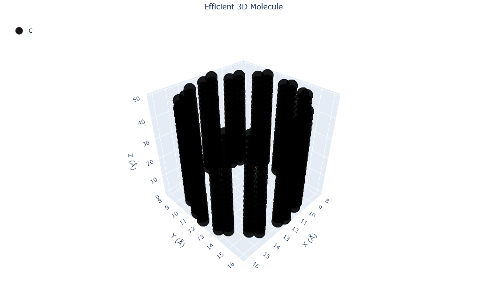

.. parsed-literal::

    Visualizing 480 atoms using matplotlib format...

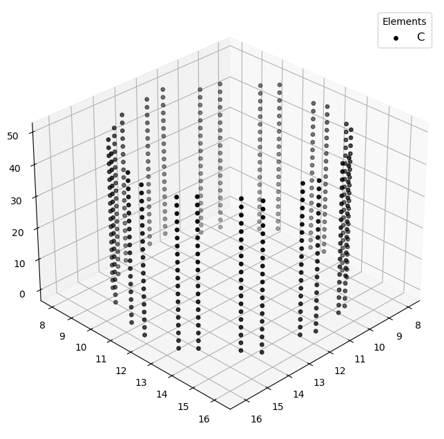

.. parsed-literal::

    Visualizing 480 atoms using pyvista format...

.. parsed-literal::

    C:\Users\karim\miniconda3\envs\science_env\lib\site-packages\pyvista\jupyter\notebook.py:37: UserWarning:
    
    Failed to use notebook backend: 
    
    No module named 'trame'
    
    Falling back to a static output.
    

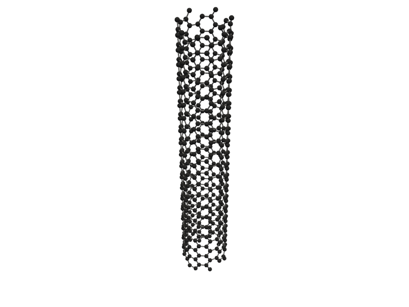

🔹 Example 2 – Gold Nanowire (material=“Au”, structure_type=“nanowire”, fcc lattice=4.08 Å, radius=1.5 nm, length=10 nm, vacuum=12 Å)
~~~~~~~~~~~~~~~~~~~~~~~~~~~~~~~~~~~~~~~~~~~~~~~~~~~~~~~~~~~~~~~~~~~~~~~~~~~~~~~~~~~~~~~~~~~~~~~~~~~~~~~~~~~~~~~~~~~~~~~~~~~~~~~~~~~~~

Here, a gold (Au) nanowire is built using an FCC crystal structure with
a lattice constant of 4.08 Å. The wire has a radius of 1.5 nm and a
length of 10 nm, with a 12 Å vacuum around it to prevent interaction
with neighboring cells.

Gold nanowires are key in nanoscale interconnects, plasmonic waveguides,
and mechanical testing at the atomic scale. Their 1D morphology enables
quantized conductance and unique surface electron behavior.

.. code:: ipython3

    from pygamlab.structures.Generators.one_d import Nano_OneD_Builder 
    
    from pygamlab.structures.gamvis import Molecular_Visualizer 
    
    builder = Nano_OneD_Builder(material="Au", structure_type="nanowire", lattice_constant=4.08, crystal_structure="fcc", radius=1.5, length=10.0, vacuum=12.0)
    oned2=builder.atoms 
     
    Molecular_Visualizer(oned2,format='efficient_plotly') 
    Molecular_Visualizer(oned2,format='matplotlib') 
    Molecular_Visualizer(oned2,format='pyvista') 

.. parsed-literal::

    Visualizing 5237 atoms using efficient_plotly format...

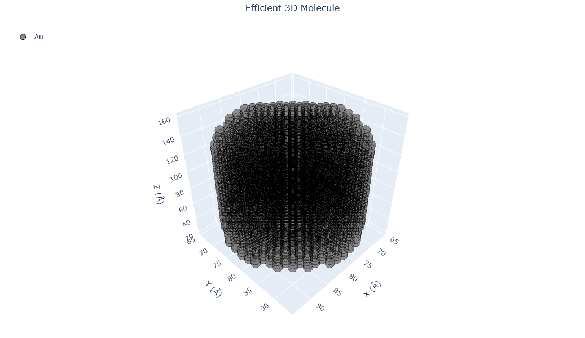

.. parsed-literal::

    Visualizing 5237 atoms using matplotlib format...

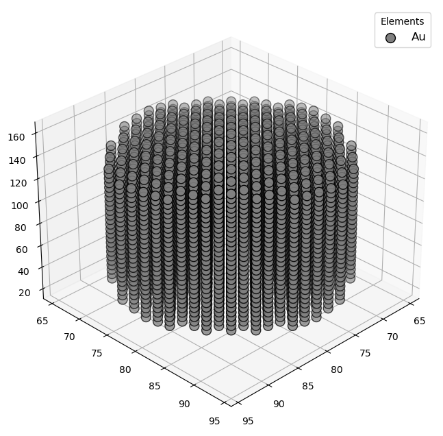

🔹 Example 3 – Silicon Nanorod (material=“Si”, structure_type=“nanorod”, diamond lattice=5.43 Å, radius=2.0 nm, length=8 nm, vacuum=10 Å)
~~~~~~~~~~~~~~~~~~~~~~~~~~~~~~~~~~~~~~~~~~~~~~~~~~~~~~~~~~~~~~~~~~~~~~~~~~~~~~~~~~~~~~~~~~~~~~~~~~~~~~~~~~~~~~~~~~~~~~~~~~~~~~~~~~~~~~~~~

This example constructs a silicon nanorod with a diamond cubic crystal
structure and a lattice constant of 5.43 Å. The nanorod’s radius is 2
nm, and its length extends to 8 nm.

Silicon nanorods are widely used in photonic crystals, sensors, and
field-emission devices, where their quantum confinement and surface
oxidation behavior can significantly alter their electronic bandgap.

This type of structure bridges the gap between 0D nanoclusters and 2D
nanowires, maintaining stability while being tunable in size and length.

.. code:: ipython3

    from pygamlab.structures.Generators.one_d import Nano_OneD_Builder 
    
    from pygamlab.structures.gamvis import Molecular_Visualizer 
    
    builder = Nano_OneD_Builder(material="Si", structure_type="nanorod", lattice_constant=5.43, crystal_structure="diamond", radius=2.0, length=8.0, vacuum=10.0)
    oned3=builder.atoms 
     
    Molecular_Visualizer(oned3,format='efficient_plotly') 
    Molecular_Visualizer(oned3,format='matplotlib') 
    Molecular_Visualizer(oned3,format='pyvista') 

.. parsed-literal::

    Visualizing 5378 atoms using efficient_plotly format...

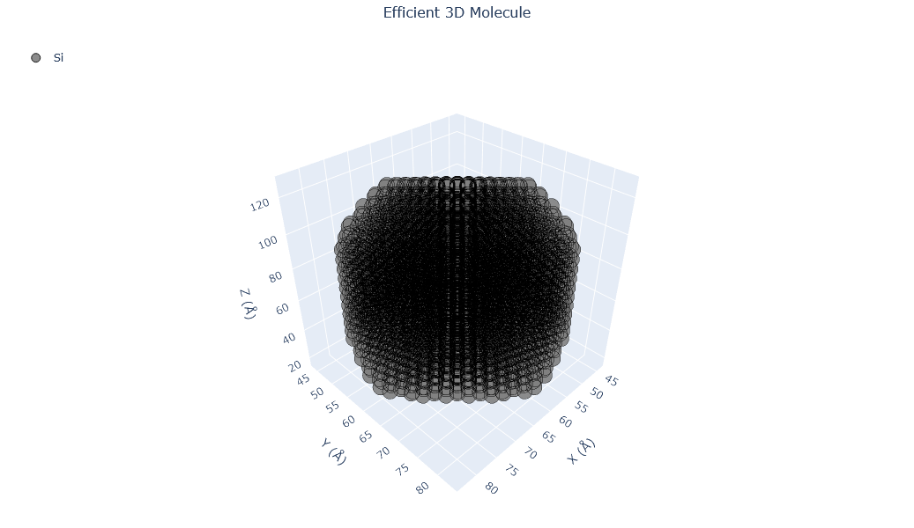

.. parsed-literal::

    Visualizing 5378 atoms using matplotlib format...

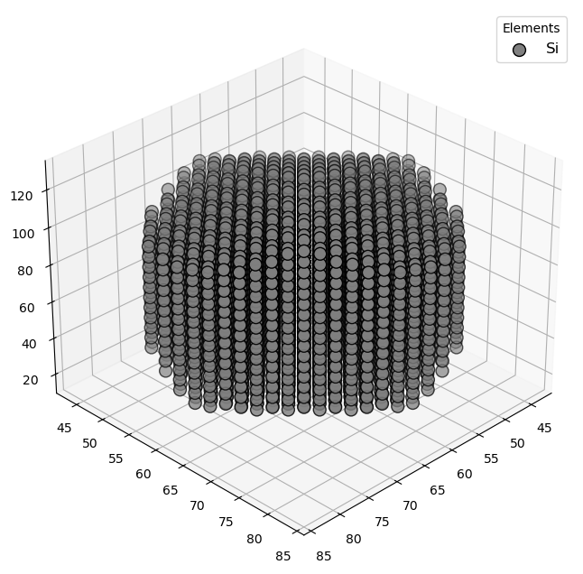

🔹 Example 4 – Defective Carbon Nanotube (material=“C”, structure_type=“nanotube”, length=6.0, defect_type=“vacancy”, concentration=0.1)
~~~~~~~~~~~~~~~~~~~~~~~~~~~~~~~~~~~~~~~~~~~~~~~~~~~~~~~~~~~~~~~~~~~~~~~~~~~~~~~~~~~~~~~~~~~~~~~~~~~~~~~~~~~~~~~~~~~~~~~~~~~~~~~~~~~~~~~~

In this case, a carbon nanotube of 6 nm length is created, and vacancy
defects are introduced at a 10% concentration. A random seed (seed=42)
ensures reproducibility of the defect pattern.

Vacancy defects — missing atoms in the lattice — strongly influence the
electrical conductivity, mechanical stiffness, and chemical reactivity
of CNTs. Such defective models are important for simulating real
experimental systems, where imperfections play a crucial role in
material performance.

.. code:: ipython3

    from pygamlab.structures.Generators.one_d import Nano_OneD_Builder 
    
    from pygamlab.structures.gamvis import Molecular_Visualizer 
    
    builder = Nano_OneD_Builder(material="C", structure_type="nanotube", length=6.0)
    builder.add_defects(defect_type="vacancy", concentration=0.1, seed=42)
    oned4=builder.atoms 
     
    Molecular_Visualizer(oned4,format='efficient_plotly') 
    Molecular_Visualizer(oned4,format='matplotlib') 
    Molecular_Visualizer(oned4,format='pyvista') 

.. parsed-literal::

    Visualizing 519 atoms using efficient_plotly format...

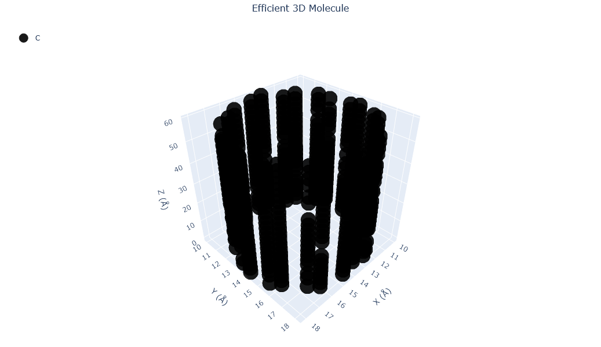

.. parsed-literal::

    Visualizing 519 atoms using matplotlib format...

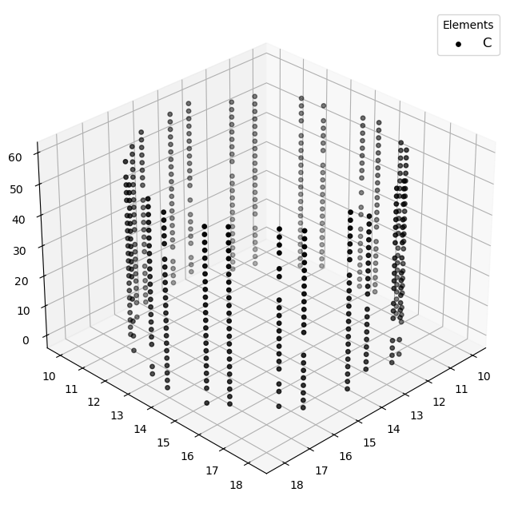

🔹 Example 5 – Defective Gold Nanowire (material=“Au”, structure_type=“nanowire”, radius=1.0 nm, length=6 nm, defect_type=“interstitial”, concentration=0.05)
~~~~~~~~~~~~~~~~~~~~~~~~~~~~~~~~~~~~~~~~~~~~~~~~~~~~~~~~~~~~~~~~~~~~~~~~~~~~~~~~~~~~~~~~~~~~~~~~~~~~~~~~~~~~~~~~~~~~~~~~~~~~~~~~~~~~~~~~~~~~~~~~~~~~~~~~~~~~~

Finally, a gold nanowire with a 1 nm radius and 6 nm length is
generated, followed by the introduction of interstitial defects at 5%
concentration. Interstitials are extra atoms inserted into the lattice,
often increasing local strain and altering electronic density near the
defect site.

This example demonstrates how Nano_OneD_Builder allows for defect
engineering, which is essential for modeling mechanical deformation,
diffusion processes, or conductivity changes in nanowires under
real-world conditions.

.. code:: ipython3

    from pygamlab.structures.Generators.one_d import Nano_OneD_Builder 
    
    from pygamlab.structures.gamvis import Molecular_Visualizer 
    
    builder = Nano_OneD_Builder(material="Au", structure_type="nanowire", lattice_constant=4.08, crystal_structure="fcc", radius=1.0, length=6.0)
    builder.add_defects(defect_type="interstitial", concentration=0.05, seed=1)
    oned5=builder.atoms 
     
    Molecular_Visualizer(oned5,format='efficient_plotly') 
    Molecular_Visualizer(oned5,format='matplotlib') 
    Molecular_Visualizer(oned5,format='pyvista') 

🧱 **Category 3 – Bulk Materials (3D Crystalline Structures)**
~~~~~~~~~~~~~~~~~~~~~~~~~~~~~~~~~~~~~~~~~~~~~~~~~~~~~~~~~~~~~~

Bulk materials are three-dimensional (3D) crystalline systems with
periodic atomic arrangements extending in all spatial directions. They
represent the infinite or macroscopic limit of materials — unlike
nanoclusters (0D), nanowires (1D), or nanosheets (2D), which are
spatially confined.

In computational materials science, bulk structures serve as the
fundamental building blocks for:

Deriving surface slabs, grain boundaries, and nanoparticles

Computing elastic constants, electronic band structures, and phonon
spectra

Performing density functional theory (DFT) simulations with periodic
boundary conditions

The AdvancedAlloys class in PyGamLab allows users to automatically
generate crystalline bulk structures, including:

Pure crystals and binary/multicomponent alloys

FCC, BCC, and HCP lattice types

Control over elemental composition, supercell size, and random
distribution (via seed control)

Below are several examples showing how to generate and visualize various
bulk systems with different compositions, structures, and sizes.

🔹 Example 1 – Cu–Ni Alloy (FCC Structure, Equal Fraction 50–50)
~~~~~~~~~~~~~~~~~~~~~~~~~~~~~~~~~~~~~~~~~~~~~~~~~~~~~~~~~~~~~~~~

In this example, a Cu–Ni binary alloy is generated with equal atomic
fractions (0.5 Cu, 0.5 Ni). Both copper and nickel share the
face-centered cubic (FCC) crystal structure, making them fully miscible
in the solid state.

This example demonstrates how substitutional alloying can be modeled in
a random atomic arrangement, suitable for simulating solid-solution
behavior and lattice distortion effects.

📘 Applications: Modeling mechanical strengthening in Cu–Ni alloys,
diffusion, and phase stability.

.. code:: ipython3

    from pygamlab.structures.Generators.auto_bulk import AdvancedAlloys 
    
    from pygamlab.structures.gamvis import Molecular_Visualizer 
    
    builder = AdvancedAlloys(elements=["Cu", "Ni"], fractions=[0.5, 0.5])
    bulk1=builder.atoms 
     
    Molecular_Visualizer(bulk1,format='efficient_plotly') 
    Molecular_Visualizer(bulk1,format='matplotlib') 
    Molecular_Visualizer(bulk1,format='pyvista') 

.. parsed-literal::

    Generated alloy with composition:
      Cu: 13 atoms (48.15%)
      Ni: 14 atoms (51.85%)
    Total atoms: 27
    Crystal structure based on Cu: fcc with lattice constant 3.615
    Supercell size: (3, 3, 3)
    Visualizing 27 atoms using efficient_plotly format...

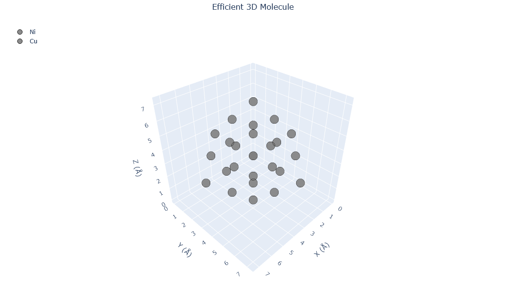

.. parsed-literal::

    Visualizing 27 atoms using matplotlib format...

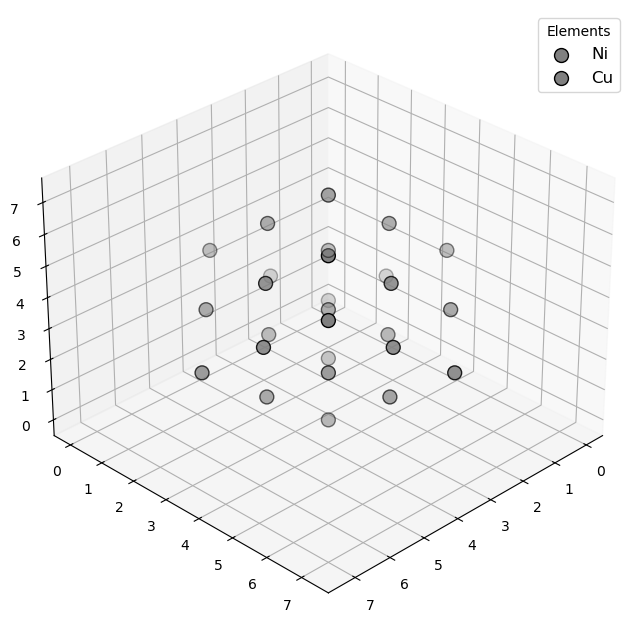

.. parsed-literal::

    Visualizing 27 atoms using pyvista format...

.. parsed-literal::

    C:\Users\karim\miniconda3\envs\science_env\lib\site-packages\pyvista\jupyter\notebook.py:37: UserWarning:
    
    Failed to use notebook backend: 
    
    No module named 'trame'
    
    Falling back to a static output.
    

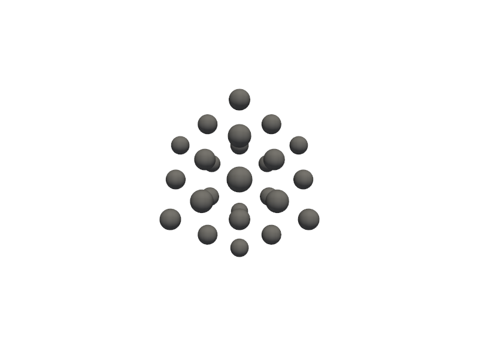

🔹 Example 2 – Fe–Cr Alloy (BCC Structure, 2×2×2 Supercell)
~~~~~~~~~~~~~~~~~~~~~~~~~~~~~~~~~~~~~~~~~~~~~~~~~~~~~~~~~~~

Here, an iron–chromium alloy is constructed with 70% Fe and 30% Cr,
expanded to a 2×2×2 supercell. Both Fe and Cr typically crystallize in
the body-centered cubic (BCC) structure, and this configuration is often
used for simulating ferritic steels.

📘 Applications: Studying corrosion resistance, magnetic properties, and
thermal expansion in Fe–Cr systems.

.. code:: ipython3

    from pygamlab.structures.Generators.auto_bulk import AdvancedAlloys 
    
    from pygamlab.structures.gamvis import Molecular_Visualizer 
    
    builder = AdvancedAlloys(elements=["Fe", "Cr"], fractions=[0.7, 0.3], supercell_size=(2, 2, 2))
    bulk2=builder.atoms 
     
    Molecular_Visualizer(bulk2,format='efficient_plotly') 
    Molecular_Visualizer(bulk2,format='matplotlib') 
    Molecular_Visualizer(bulk2,format='pyvista') 

.. parsed-literal::

    Generated alloy with composition:
      Fe: 6 atoms (75.00%)
      Cr: 2 atoms (25.00%)
    Total atoms: 8
    Crystal structure based on Fe: bcc with lattice constant 2.866
    Supercell size: (2, 2, 2)
    Visualizing 8 atoms using efficient_plotly format...

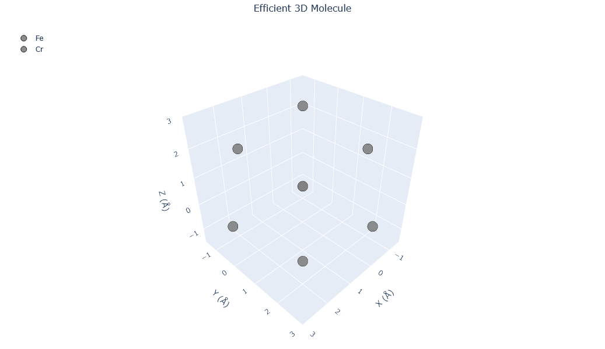

.. parsed-literal::

    Visualizing 8 atoms using matplotlib format...

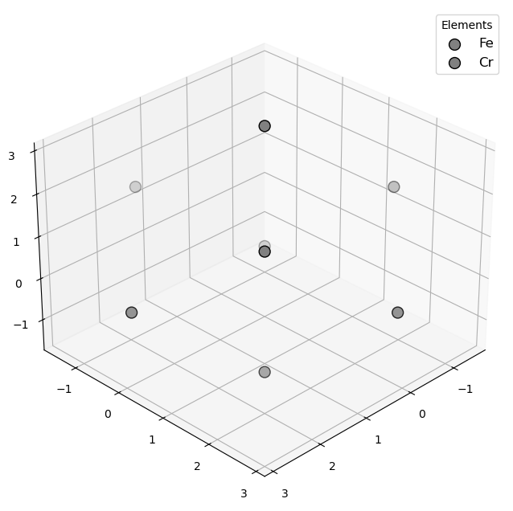

🔹 Example 3 – Large Fe–Cr Alloy Supercell (5×5×5 Expansion)
~~~~~~~~~~~~~~~~~~~~~~~~~~~~~~~~~~~~~~~~~~~~~~~~~~~~~~~~~~~~

In this case, the Fe–Cr alloy is scaled up to a 5×5×5 supercell,
generating a much larger atomic system. Such models are useful for Monte
Carlo or Molecular Dynamics simulations, where bulk-like statistical
behavior and defect diffusion are of interest.

📘 Applications: Thermodynamic stability, large-scale defect
simulations, or mechanical stress testing under periodic conditions.

.. code:: ipython3

    from pygamlab.structures.Generators.auto_bulk import AdvancedAlloys 
    
    from pygamlab.structures.gamvis import Molecular_Visualizer 
    
    builder = AdvancedAlloys(elements=["Fe", "Cr"], fractions=[0.7, 0.3], supercell_size=(5, 5, 5))
    bulk3=builder.atoms 
     
    Molecular_Visualizer(bulk3,format='efficient_plotly') 
    Molecular_Visualizer(bulk3,format='matplotlib') 
    Molecular_Visualizer(bulk3,format='pyvista') 

.. parsed-literal::

    Generated alloy with composition:
      Fe: 87 atoms (69.60%)
      Cr: 38 atoms (30.40%)
    Total atoms: 125
    Crystal structure based on Fe: bcc with lattice constant 2.866
    Supercell size: (5, 5, 5)
    Visualizing 125 atoms using efficient_plotly format...

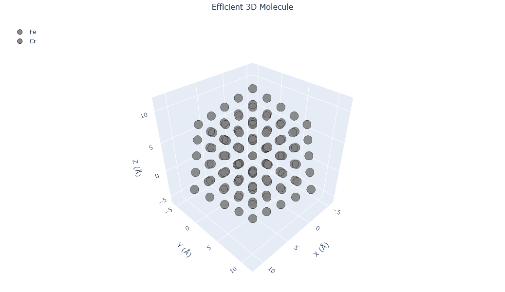

.. parsed-literal::

    Visualizing 125 atoms using matplotlib format...

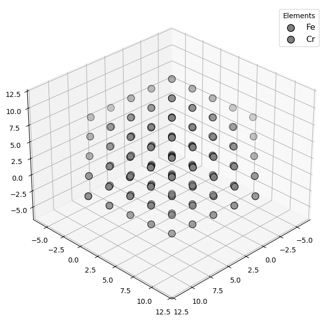

🔹 Example 4 – Al–Mg Random Alloy (FCC, Seed Control for Reproducibility)
~~~~~~~~~~~~~~~~~~~~~~~~~~~~~~~~~~~~~~~~~~~~~~~~~~~~~~~~~~~~~~~~~~~~~~~~~

This example creates an Al–Mg solid solution with a 60–40 atomic ratio.
The parameter seed=42 ensures that the random distribution of Mg atoms
within the Al matrix is reproducible across different runs.

📘 Applications: Al–Mg alloys are widely used in lightweight structural
materials, aerospace, and automotive industries. This simulation setup
helps study how Mg atoms influence mechanical hardening and defect
migration.

.. code:: ipython3

    from pygamlab.structures.Generators.auto_bulk import AdvancedAlloys 
    
    from pygamlab.structures.gamvis import Molecular_Visualizer 
    
    builder = AdvancedAlloys(elements=["Al", "Mg"], fractions=[0.6, 0.4], seed=42)
    bulk4=builder.atoms 
     
    Molecular_Visualizer(bulk4,format='efficient_plotly') 
    Molecular_Visualizer(bulk4,format='matplotlib') 
    Molecular_Visualizer(bulk4,format='pyvista') 

.. parsed-literal::

    Generated alloy with composition:
      Al: 16 atoms (59.26%)
      Mg: 11 atoms (40.74%)
    Total atoms: 27
    Crystal structure based on Al: fcc with lattice constant 4.05
    Supercell size: (3, 3, 3)
    Visualizing 27 atoms using efficient_plotly format...

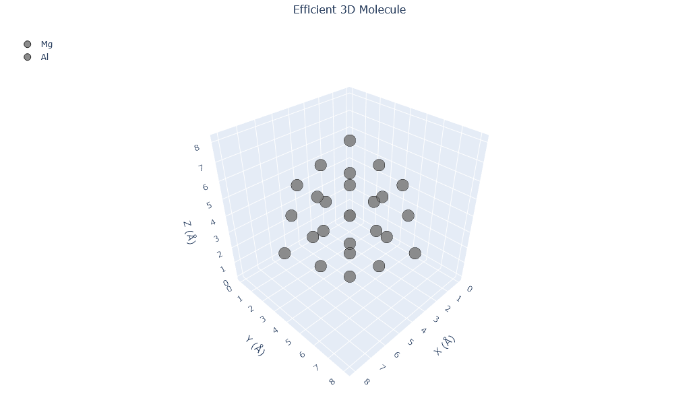

.. parsed-literal::

    Visualizing 27 atoms using matplotlib format...

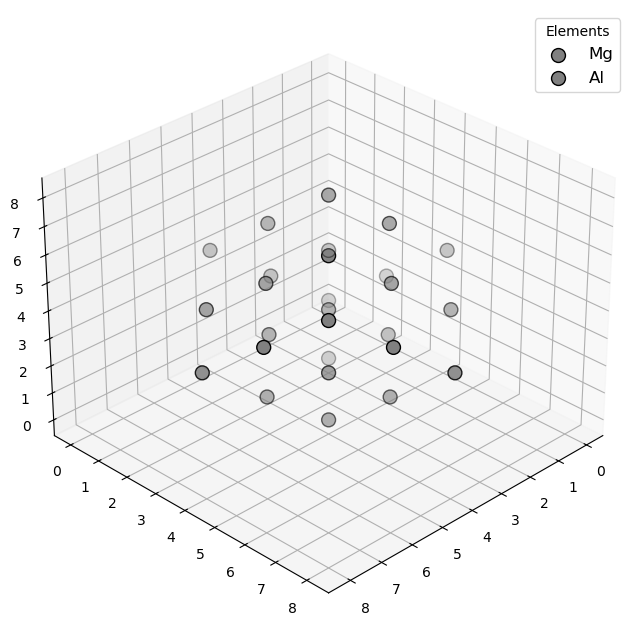

🔹 Example 5 – Ti–Al Alloy (HCP Crystal, User-Defined Lattice Constants)
~~~~~~~~~~~~~~~~~~~~~~~~~~~~~~~~~~~~~~~~~~~~~~~~~~~~~~~~~~~~~~~~~~~~~~~~

In the final example, a Ti–Al binary alloy is generated, both using
hexagonal close-packed (HCP) crystal structures with user-defined
lattice constants: a = 2.95 Å, c = 4.68 Å.

This configuration represents an ordered Ti–Al intermetallic phase,
which is significant in high-temperature alloys and turbine
applications.

📘 Applications: Modeling TiAl-based intermetallics, phase
transformations, and anisotropic mechanical behavior.

.. code:: ipython3

    from pygamlab.structures.Generators.auto_bulk import AdvancedAlloys 
    
    from pygamlab.structures.gamvis import Molecular_Visualizer 
    
    builder = AdvancedAlloys(elements=["Ti", "Al"], fractions=[0.5, 0.5], crystal_structures=["hcp", "hcp"], lattice_constants=[{"a": 2.95, "c": 4.68}, {"a": 2.95, "c": 4.68}])
    bulk5=builder.atoms 
     
    Molecular_Visualizer(bulk5,format='efficient_plotly') 
    Molecular_Visualizer(bulk5,format='matplotlib') 
    Molecular_Visualizer(bulk5,format='pyvista') 

.. parsed-literal::

    Generated alloy with composition:
      Ti: 27 atoms (50.00%)
      Al: 27 atoms (50.00%)
    Total atoms: 54
    Crystal structure based on Ti: hcp with lattice constant {'a': 2.95, 'c': 4.68}
    Supercell size: (3, 3, 3)
    Visualizing 54 atoms using efficient_plotly format...

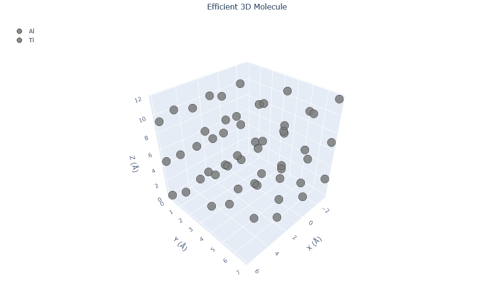

.. parsed-literal::

    Visualizing 54 atoms using matplotlib format...

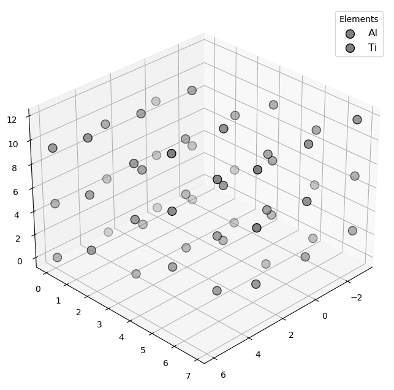

🧩 **Category 4 – Two-Dimensional (2D) Materials**
~~~~~~~~~~~~~~~~~~~~~~~~~~~~~~~~~~~~~~~~~~~~~~~~~~

Two-dimensional (2D) materials are crystalline structures that consist
of a single or few atomic layers. They represent a class of materials
where atoms are strongly bonded within the plane but weakly bonded
between layers via van der Waals interactions.

This reduced dimensionality gives rise to remarkable physical, chemical,
and electronic properties, such as:

High carrier mobility and mechanical strength (e.g., in graphene)

Tunable band gaps (e.g., in MoS₂ or WS₂)

High surface area-to-volume ratio

Excellent flexibility and transparency

The Nano_TwoD_Builder in PyGamLab provides a powerful way to
automatically construct different types of 2D materials, including:

Nanosheets like graphene, silicene, phosphorene

Transition metal dichalcogenides (TMDs) such as WS₂, MoS₂, VSe₂

These 2D systems are the foundation of next-generation electronics,
sensors, catalysts, and energy storage devices.

🔹 Example 1 – Graphene Nanosheet
~~~~~~~~~~~~~~~~~~~~~~~~~~~~~~~~~

In this example, a graphene nanosheet is generated using the
Nano_TwoD_Builder. Graphene is composed of sp²-bonded carbon atoms
arranged in a hexagonal honeycomb lattice. It exhibits exceptional
electrical conductivity, mechanical strength, and thermal stability.

📘 Applications: Transistors, flexible electronics, conductive coatings,
and composite reinforcement.

.. code:: ipython3

    from pygamlab.structures.Generators.two_d import Nano_TwoD_Builder 
    
    from pygamlab.structures.gamvis import Molecular_Visualizer 
    
    builder = Nano_TwoD_Builder(material="graphene", structure_type="nanosheet")
    twod1=builder.atoms 
     
    Molecular_Visualizer(twod1,format='efficient_plotly') 
    Molecular_Visualizer(twod1,format='matplotlib') 
    Molecular_Visualizer(twod1,format='pyvista') 

.. parsed-literal::

    Visualizing 200 atoms using efficient_plotly format...

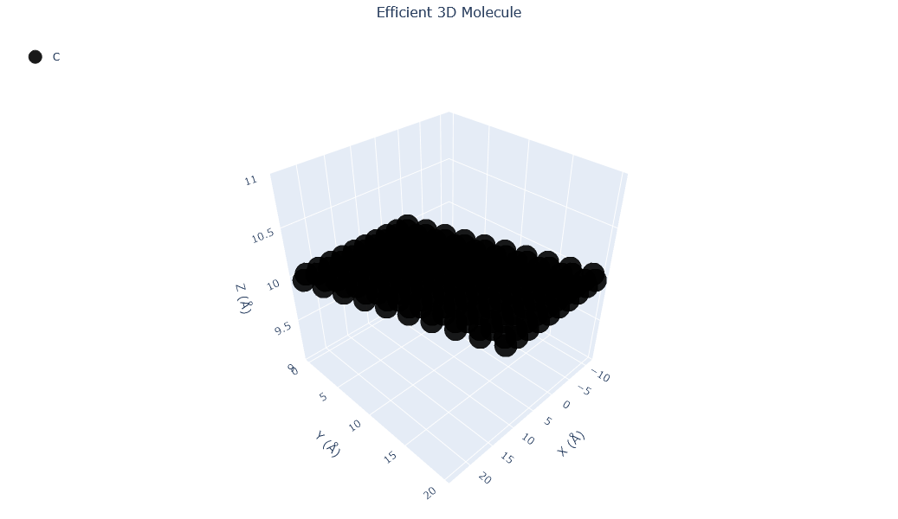

.. parsed-literal::

    Visualizing 200 atoms using matplotlib format...

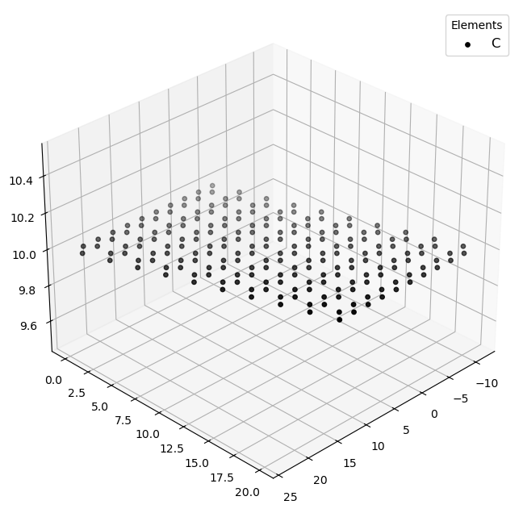

🔹 Example 2 – Silicene Nanosheet
~~~~~~~~~~~~~~~~~~~~~~~~~~~~~~~~~

This example builds a silicene sheet, a 2D allotrope of silicon with a
slightly buckled hexagonal structure due to its larger atomic radius
compared to carbon. Although it shares graphene’s honeycomb arrangement,
silicene exhibits different electronic behavior, often showing
Dirac-like dispersion but with a tunable bandgap.

📘 Applications: Nanoelectronics, spintronics, and silicon-compatible
device integration.

.. code:: ipython3

    from pygamlab.structures.Generators.two_d import Nano_TwoD_Builder 
    
    from pygamlab.structures.gamvis import Molecular_Visualizer 
    
    builder = Nano_TwoD_Builder(material="silicene", structure_type="nanosheet")
    twod2=builder.atoms 
     
    Molecular_Visualizer(twod2,format='efficient_plotly') 
    Molecular_Visualizer(twod2,format='matplotlib') 
    Molecular_Visualizer(twod2,format='pyvista') 

.. parsed-literal::

    Visualizing 200 atoms using efficient_plotly format...

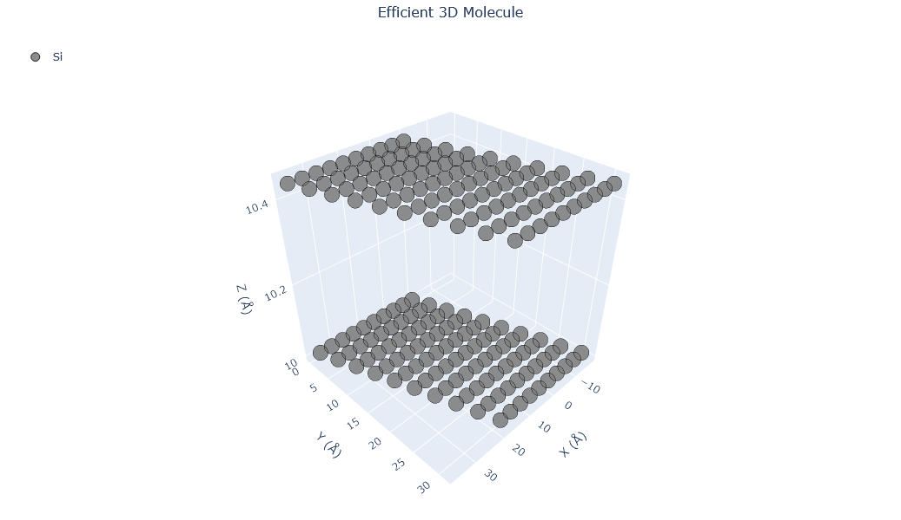

.. parsed-literal::

    Visualizing 200 atoms using matplotlib format...

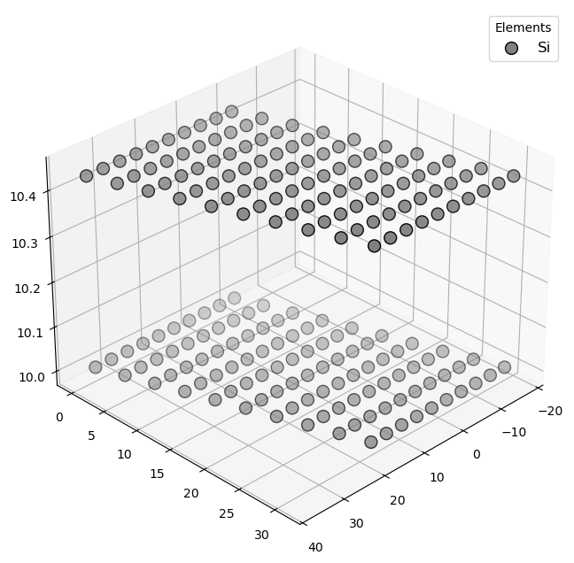

🔹 Example 3 – WS₂ Monolayer (Transition Metal Dichalcogenide)
~~~~~~~~~~~~~~~~~~~~~~~~~~~~~~~~~~~~~~~~~~~~~~~~~~~~~~~~~~~~~~

Here, a tungsten disulfide (WS₂) monolayer is generated, representing a
TMD (Transition Metal Dichalcogenide) structure. Unlike graphene, WS₂
has a direct bandgap in the monolayer form, making it ideal for
optoelectronic and photonic applications.

📘 Applications: Photodetectors, field-effect transistors (FETs), and
valleytronic devices.

.. code:: ipython3

    from pygamlab.structures.Generators.two_d import Nano_TwoD_Builder 
    
    from pygamlab.structures.gamvis import Molecular_Visualizer 
    
    builder = Nano_TwoD_Builder(material="ws2", structure_type="tmd")
    twod3=builder.atoms 
     
    Molecular_Visualizer(twod3,format='efficient_plotly') 
    Molecular_Visualizer(twod3,format='matplotlib') 
    Molecular_Visualizer(twod3,format='pyvista') 

.. parsed-literal::

    Visualizing 300 atoms using efficient_plotly format...

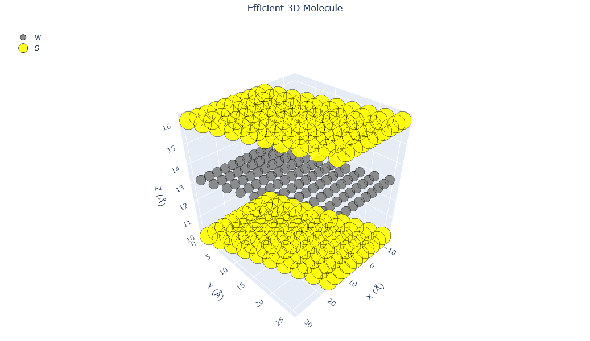

.. parsed-literal::

    Visualizing 300 atoms using matplotlib format...

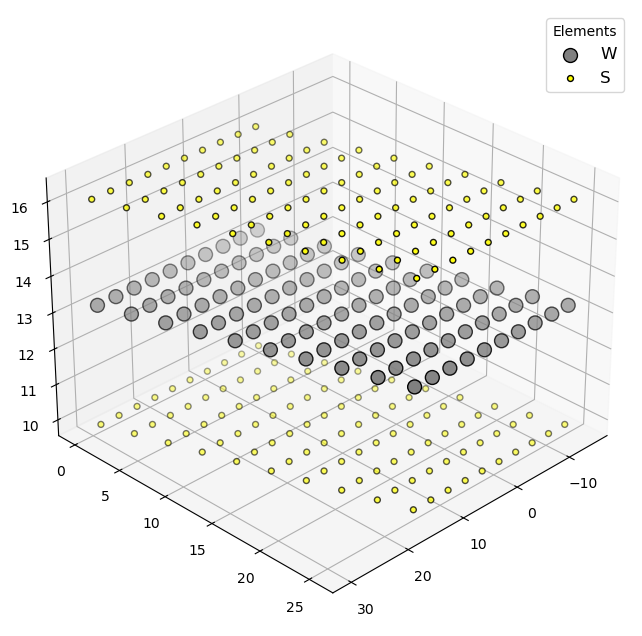

🔹 Example 4 – VSe₂ Monolayer (Magnetic TMD)
~~~~~~~~~~~~~~~~~~~~~~~~~~~~~~~~~~~~~~~~~~~~

In this example, a vanadium diselenide (VSe₂) monolayer is generated. It
belongs to the TMD family but is unique because it exhibits intrinsic
magnetism in its monolayer form — a property not common in 2D systems.

📘 Applications: 2D magnetism studies, spintronic devices, and magnetic
heterostructures.

.. code:: ipython3

    from pygamlab.structures.Generators.two_d import Nano_TwoD_Builder 
    
    from pygamlab.structures.gamvis import Molecular_Visualizer 
    
    builder = Nano_TwoD_Builder(material="vse2", structure_type="tmd")
    twod4=builder.atoms 
     
    Molecular_Visualizer(twod4,format='efficient_plotly') 
    Molecular_Visualizer(twod4,format='matplotlib') 
    Molecular_Visualizer(twod4,format='pyvista') 

.. parsed-literal::

    Visualizing 300 atoms using efficient_plotly format...

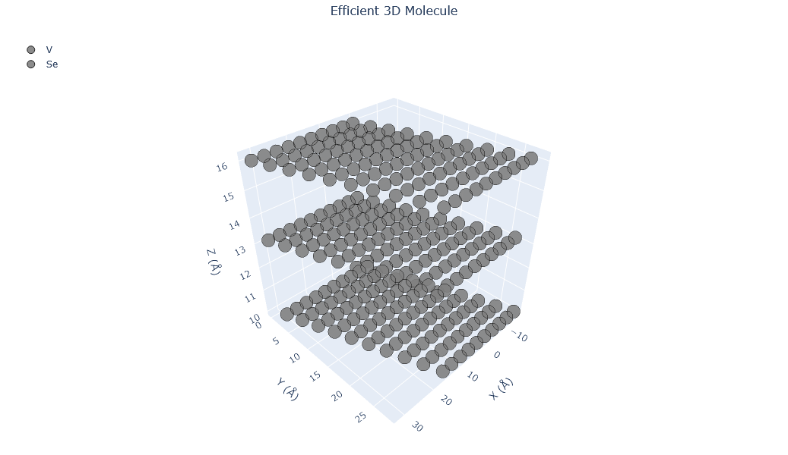

.. parsed-literal::

    Visualizing 300 atoms using matplotlib format...

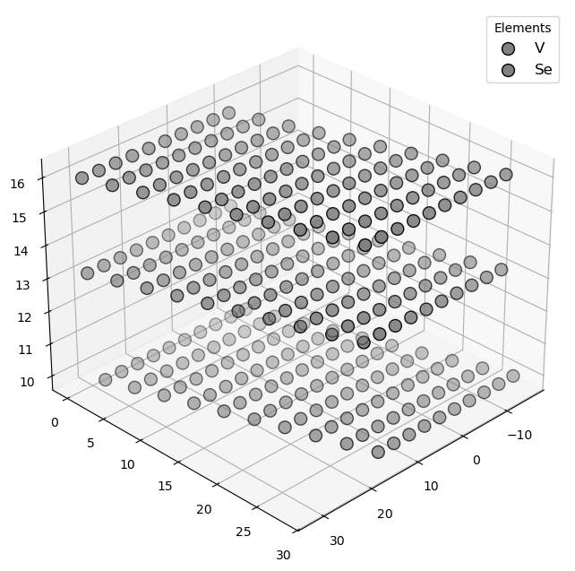

🔹 Example 5 – Phosphorene Nanosheet
~~~~~~~~~~~~~~~~~~~~~~~~~~~~~~~~~~~~

Finally, a phosphorene nanosheet (a single layer of black phosphorus) is
created. Phosphorene has a puckered orthorhombic structure and exhibits
anisotropic electrical and mechanical properties, meaning its behavior
depends on the direction within the plane.

📘 Applications: Energy storage (Li-ion batteries), sensors, and
field-effect transistors with tunable bandgaps.

.. code:: ipython3

    from pygamlab.structures.Generators.two_d import Nano_TwoD_Builder 
    
    from pygamlab.structures.gamvis import Molecular_Visualizer 
    
    builder = Nano_TwoD_Builder(material="phosphorene", structure_type="nanosheet")
    twod4=builder.atoms 
     
    Molecular_Visualizer(twod4,format='efficient_plotly') 
    Molecular_Visualizer(twod4,format='matplotlib') 
    Molecular_Visualizer(twod4,format='pyvista') 

.. parsed-literal::

    Visualizing 200 atoms using efficient_plotly format...

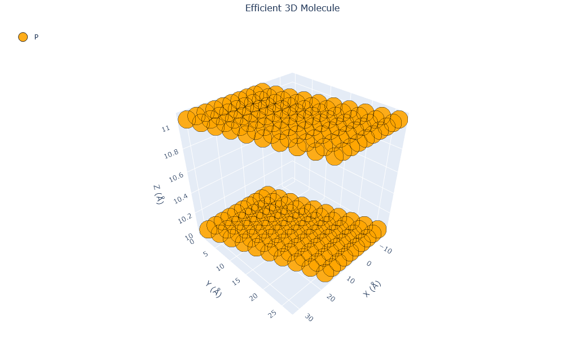

.. parsed-literal::

    Visualizing 200 atoms using matplotlib format...

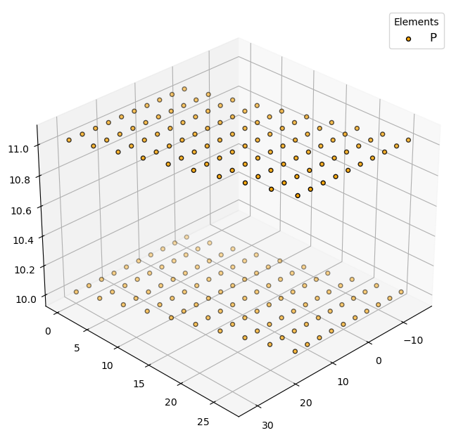

.. parsed-literal::

    Visualizing 200 atoms using pyvista format...

.. parsed-literal::

    C:\Users\karim\miniconda3\envs\science_env\lib\site-packages\pyvista\jupyter\notebook.py:37: UserWarning:
    
    Failed to use notebook backend: 
    
    No module named 'trame'
    
    Falling back to a static output.
    

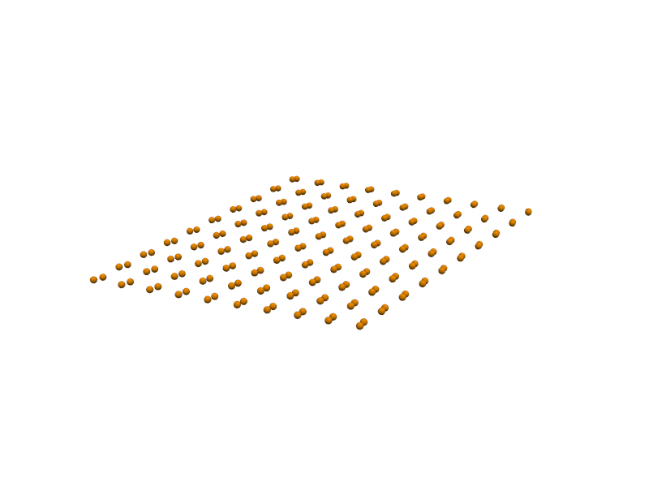

